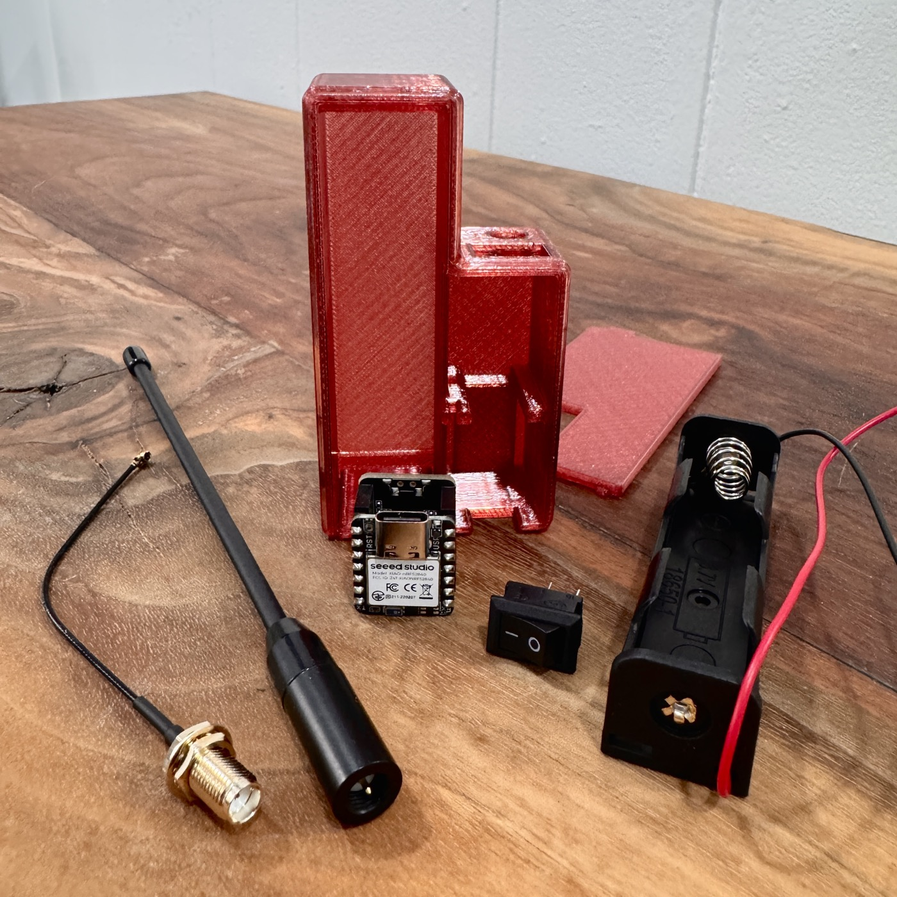
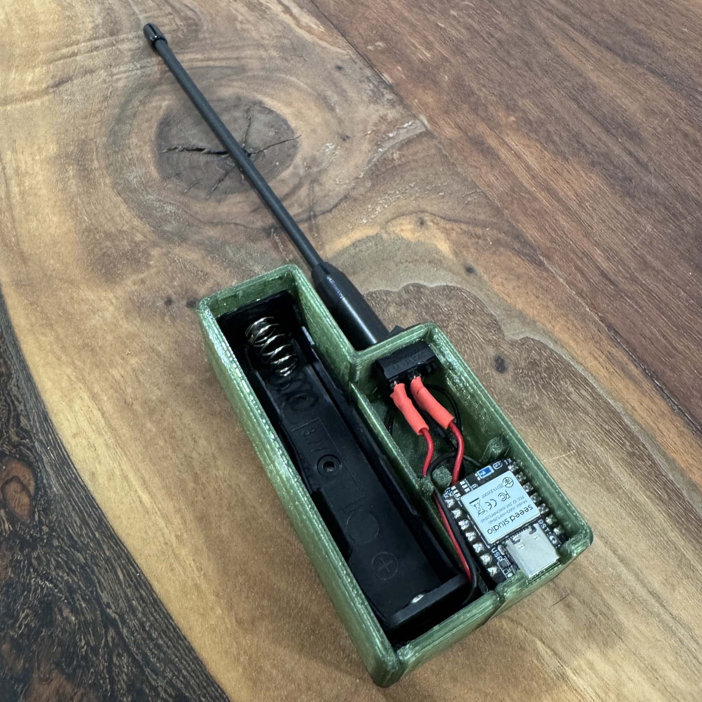
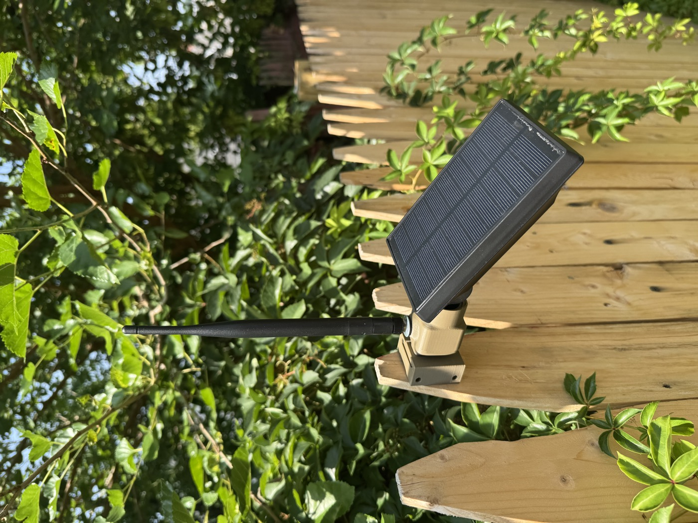
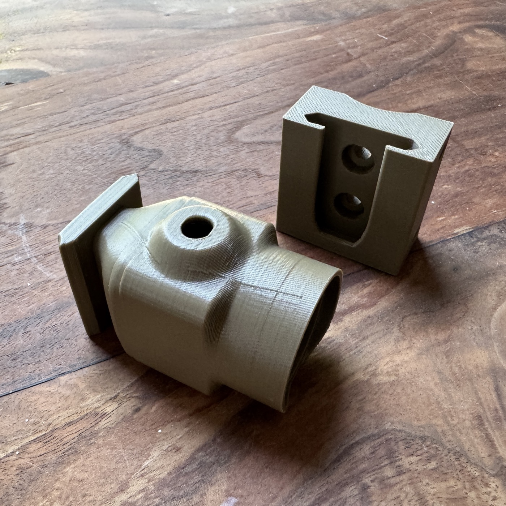

# The People's Mesh Kit: Build Guide

**One guide, two radios:** the *People's Companion* (the one you carry) and the *People's Repeater* (the solar one you mount up high). Both are by Black Flag Civilian (BFC). This guide follows his two videos and Printables listings step for step. It adds the checks, settings and group-session notes needed to build a batch for friends and neighbors.

| | People's Companion | People's Repeater |
|---|---|---|
| Video | [A $25 Radio that Sends Encrypted Text Messages](https://youtu.be/RTBM0CscnLI) (build starts 14:00) | [A $35 Solar Mesh Node Anyone Can Build](https://youtu.be/yAmINEghCOc) (build starts 15:35) |
| Files | [Printables 1832924](https://www.printables.com/model/1832924) → `stl/companion/` | [Printables 1768397](https://www.printables.com/model/1768397) → `stl/repeater/` |
| Job | Pairs with your phone over Bluetooth; you send and read messages | Hears and re-broadcasts everyone's messages; no phone needed |
| Power | One swappable 18650 cell, about 2 weeks per charge | Garden-light solar panel + 18650, charges itself |
| Weather | **Not waterproof.** Keep it dry. | Weather-resistant (ASA hub, O-ring) |
| Build time | 15–45 min | 30–60 min |
| Parts cost | about $25–31 | about $36–41 |

Contents: [Part 0: Same radio, different firmware](#part-0-same-radio-different-firmware) · [Part 1: Print](#part-1-print-the-parts) · [Part 2: Shared prep](#part-2-shared-prep-every-radio) · [Part C: Build the Companion](#part-c-build-the-peoples-companion) · [Part R: Build the Repeater](#part-r-build-the-peoples-repeater) · [Part F: Flash & configure](#part-f-flash--configure-meshcore) · [Part T: Test, deploy, troubleshoot](#part-t-test-deploy-troubleshoot)

---

## Part 0: Same radio, different firmware

Your hunch is **half right.** The radio is identical. The rest of the build is not.

**Identical in both:**

- The radio: **Seeed Studio XIAO nRF52840 & Wio-SX1262 Kit**. It's two little boards that friction-fit together: the **XIAO nRF52840** (the one with the USB-C port, with the battery pads underneath) and the **Wio-SX1262** LoRa board (with the tiny IPEX/U.FL antenna socket).
- A 915 MHz antenna on an SMA connector, fed by a short IPEX-to-SMA cable.
- An 18650 lithium cell, soldered to the XIAO's BAT+ / BAT− pads.
- The firmware family: **MeshCore v1.18.0** for "Seeed Studio Xiao nRF52 WIO".

**What's different:**

| | Companion | Repeater |
|---|---|---|
| **Firmware role** | **Companion (Bluetooth)** | **Repeater** |
| Printed parts | Enclosure + Cap, **PETG** | Hub + Mount, **ASA** |
| Power path | 18650 holder → on/off rocker switch → XIAO | Solar panel + 18650 → **CN3065 charge board** → XIAO |
| Wiring method | Solder wires directly | Solder 3 × **JST PH2.0** pigtails, then plug in |
| Antenna | BFC whip + **10 cm** IPEX cable (fits the small housing) | 3 dBi whip + **15 cm** U.FL bulkhead cable, sealed with a **bonded washer** |
| Donor parts | none | **Harbor Breeze solar spot light (Lowe's)** |
| Set up with | Phone app (MeshCore) over Bluetooth | Web flasher's Repeater Setup over USB |

In theory any kit can be flashed as either role. In practice the housing and power wiring decide what each unit is. Flash the role that matches the build.

> **About the repeater video's audio:** the auto-captions say "Meshtastic" at 31:00–33:40. The steps shown there are MeshCore repeater steps: admin password, login, telemetry, hop path, and the 910.525 MHz preset. Both of BFC's designs also run Meshtastic. This guide uses **MeshCore for both radios** so a companion and a repeater from the same session talk to each other. Use what your neighborhood uses (see F-0).

---

## Part 1: Print the parts

All STLs are in `stl/`. Checksums are in `stl/SHA256SUMS`. The designer released them as **CC0 (public domain)**. Print each part **as oriented in the file, no supports.** Full slicer notes for a Bambu P1S with a 0.6 mm nozzle: [docs/printing.md](docs/printing.md).

| Part | File | Material | Walls | Infill | Max filament |
|---|---|---|---|---|---|
| Companion enclosure | `stl/companion/PeoplesCompanionEnclosureV1.0.stl` | PETG (translucent shows the blue LED) | 3–4 | 30–40% | 36 g |
| Companion cap | `stl/companion/PeoplesCompanionCapV1.0.stl` | PETG | 3–4 | 30–40% | 13 g |
| Repeater hub | `stl/repeater/PeoplesRepeaterHubV1.1.stl` | **ASA** | **5–6** | 30–40% | 47 g |
| Repeater mount | `stl/repeater/PeoplesRepeaterMountV1.1.stl` | ASA | 2–3 | 20–30% | 27 g |

Layer height 0.2 mm on all parts. **Do not use PLA or PLA+.** It warps in a hot car or in sun. For the hub, slow speeds, a ~100 °C bed and an enclosure above 40 °C prevent warping. More walls make the hub more waterproof. (The "max filament" column is the solid-part weight, so real use is lower.)

**Print one set first and test-fit it** (cap snap, rocker switch, SMA hole, and the hub ↔ light junction) before printing a batch.

---

## Part 2: Shared prep (every radio)

- [ ] **Read the safety box.**
  > ⚠️ **18650 cells store a lot of energy.** Never short the leads. Never solder directly onto a cell. Never insert a cell backwards. Discard any cell with a torn wrapper or a dent. Ship and store cells in a case. Keep cells out of the holder while soldering.
  > ⚠️ **Polarity kills boards.** The XIAO has no reverse-polarity protection. Check red = + with a multimeter **before** a battery ever touches a board.
  > ⚠️ **Antenna before power.** Never power a radio without its antenna attached.
- [ ] **Bench-test every radio kit before you solder anything** (strongly recommended for batches). Plug the stock antenna onto the Wio board, plug the XIAO into a computer by USB-C, and flash it (Part F). A dead-on-arrival board found now costs 2 minutes. Found after soldering, it costs an hour.
- [ ] Separate the XIAO kit: pull the XIAO (USB-C board) straight off the Wio-SX1262 board. It's a friction fit. Unclip the stock antenna from the Wio board's IPEX socket and set it aside. These sockets are only rated for a handful of connect cycles, so be gentle.
- [ ] Find the **BAT+** and **BAT−** pads on the **underside of the XIAO** (the USB-C board). Read the silkscreen on *your* board and keep a phone photo of it handy.

---

## Part C: Build the People's Companion

*All the parts: printed enclosure + cap, XIAO kit, BFC antenna + 10 cm cable, rocker switch, 18650 holder. Photo: Black Flag Civilian (CC0).*

**You need:** printed enclosure + cap · XIAO kit · BFC antenna + 10 cm SMA-to-IPEX cable · 18650 holder with leads · mini rocker switch · one 18650 · (optional) heat shrink.
**Tools:** soldering iron + solder · wire stripper/cutter · small wrench · tweezers (helpful) · multimeter (recommended).

**C-1: Battery holder into housing** (video 15:00)
Thread the holder's wires through its end slots, through the battery compartment, and out the cable-management hole on the far side. Press the holder into the housing. Route the wires through the clip in the center column.

**C-2: SMA connector** (15:50)
Remove the nut and lock washer from the cable's SMA end. Push the SMA through the housing's SMA hole from inside. Put the washer on the outside, spin the nut on, and snug it with the wrench.

**C-3: Antenna cable to the radio** (16:20)
Clip the 10 cm cable's IPEX end onto the **Wio-SX1262 board**. Line it up flat and press straight down until it clicks. Give the cable one 360° twist so the slack coils into the cable-management space. Press the Wio board into its pocket, pushing the battery wires aside if needed.

**C-4: Rocker switch** (18:00)
Rock the switch into its shelf until flush. BFC's tip: put **OFF toward the inside** of the device so it's harder to bump off. Cut the **red** battery wire just past the switch terminals. **Keep the cut-off piece.** It becomes the jumper from the switch to BAT+.

**C-5: Strip** (19:10)
Strip a few mm from all four red ends: both ends of the jumper, and the two ends at the switch. Twist the strands.

**C-6: Solder** (20:00)
1. **Switch OFF** (open circle). No battery in the holder.
2. Tin both **BAT pads** on the underside of the XIAO. Make sure the two blobs **do not touch**.
3. Solder the **black** holder wire → **BAT−**.
4. Solder one end of the red **jumper** → **BAT+**.
5. Plug the XIAO back onto the Wio board, **USB-C facing down** toward the housing's pass-through.
6. Trim the reds so they reach the switch posts with only a little slack. Slide on heat shrink now if you're using it. Tin the switch posts, then solder **battery red → one post** and **jumper red → the other post.**
7. Shrink the tubing with brief heat. Too much heat warps PETG.

**Multimeter check (recommended):** with a cell in and the switch ON, measure **+3.0 to 4.2 V** from BAT+ to BAT− at the pads. A negative reading means the wiring is reversed: remove the cell immediately.

*Finished interior. Photo: Black Flag Civilian (CC0).*

**C-7: Close up** (24:00)
Insert the 18650 (**check the + end**). Hook the cap's tabs at the battery end, pivot it down, and pull the small tab out a few mm so the cap seats. Screw the antenna on. **Now** switch ON.

**C-8 → C-10:** flash **Companion (Bluetooth)**, pair with the phone app, and join channels. See **[Part F](#part-f-flash--configure-meshcore)**.

**Living with it:** one ~2500–3000 mAh cell lasts about two weeks. To swap, press the cap at the USB-C end and it pops off. USB-C charging goes through the XIAO's small built-in charger. It is **slow**, and it only reaches the cell with the switch **ON** (the switch sits between cell and board). For a group, a spare cell and a stand-alone 18650 charger are the easy answer.

---

## Part R: Build the People's Repeater

*A finished People's Repeater on a fence post. Photo: Black Flag Civilian (CC0).*

**You need:** printed hub + mount · Harbor Breeze 60 lm solar spot light (Lowe's) · XIAO kit · CN3065 solar charge board · 915 MHz antenna + U.FL-to-SMA bulkhead cable · 3 × **male** PH2.0 pigtails · 1/4" bonded sealing washer · tape · 2 screws or zip ties.
**Tools:** Phillips screwdriver · small wrench · needle-nose pliers · small **and** large cutters · soldering iron + solder · **safety glasses** · multimeter (recommended).

**R-1: Lay everything out** (video 15:35). Charge the light's cell or a replacement cell if you can.

**R-2: Bulkhead into the hub** (16:05). *This is the hardest step.*
Push the SMA bulkhead into the hub (needle-nose pliers help). Work the **bonded washer** over the first few threads. Press a finger through the hub's front opening against the back of the bulkhead, then twist the washer down slowly. Run the nut down onto the washer and compress it with the wrench: **tight, but not crack-the-print tight.** Route the coax out the main opening.

**R-3: Fix pigtail polarity** (17:20)
Look at the CN3065's **silkscreen +/−** next to each socket and compare it with your pigtail plugs. BFC's batch was pinned backwards. If yours are too, gently pull each wire out of the plastic shell (hold the shell, pull the wire), swap red and black, and click them back in. Do this on all 3. Afterward, **red must land on + of the board.** Confirm with the multimeter in continuity mode.

**R-4: Harvest the garden light** (18:40). *Safety glasses on.*
Keep the **solar panel with its compartment** and the **swivel junction with its rubber O-ring.** Everything else goes. Unscrew the front panel, snip the LED wire, and toss the reflector and LED. Cut the brittle housing away with the large cutters. Near the junction, switch to the small cutters and cut **between the four teeth**, on opposite sides, until the last ring falls off. Peel off the label. *Go slowly: a broken junction means buying another light.*

**R-5: Gut the panel compartment** (21:00)
Remove the back screws (keep them!) and cut the wires in the middle. Unscrew and remove the little switch module, then cut its remaining wires. **Tape over the rubber switch plug** so water can't get in.

**R-6: Solar panel → pigtail #1** (22:10)
Work one wire at a time so you can't lose track. Desolder the **black** wire and attach the pigtail's black right away. Then desolder the **white** wire (white is the panel's **positive**) and attach the pigtail's **red** in its place.

**R-7: Battery box → pigtail #2** (23:50)
**Remove the cell first.** Swap the old wires for pigtail #2 one at a time: red → +, black → −. Add solder if the old blob is too small.

**R-8: Radio → pigtail #3** (25:10). *These are the tiniest pads.*
Separate the boards. Tin the **BAT+ / BAT− pads under the XIAO** (USB-C board). Bend the wire tips 90° so the pigtail exits **away from the USB-C end**. Solder **red → BAT+** and **black → BAT−**. Make sure the joints don't touch. Leave the boards apart for now.

**R-9: Coax through the junction, snap on the hub** (27:00)
Remove the junction's thumb screw and captive nut. Feed the hub's coax through both junction pieces into the panel compartment. Reassemble the junction and tighten the thumb screw and nut. Push the hub onto the junction with steady, even pressure until it **snaps**. Twist-test it: the panel should rotate about 90° each way without popping off.

**R-10: Coax to the radio** (28:50)
Lay the Wio board flat, line up the U.FL plug, and press straight down until it clicks. Don't fiddle with it afterward. U.FL connectors are fragile. **Screw the antenna onto the hub now.** Then rejoin the XIAO onto the Wio board.

**R-11: Plug into the CN3065** (30:20), in this order: **SOLAR**, then **BAT**, then **SYS OUT** (radio). The board labels its sockets. The radio powers up as soon as battery and radio are both plugged in (green LED flashes). A low cell can be bench-charged through the CN3065's micro-USB port.

**R-12: Flash Repeater firmware + configure.** See **[Part F](#part-f-flash--configure-meshcore)**.

**R-13: Test, then seal** (33:40). Run the function test in Part T. Pack the boards inside the panel compartment and replace the four corner screws.

**Mount:** the mount takes 2 screws (fence, wall) or 2 zip ties (mast, pole). The hub slides in from the top and gravity holds it. Loosen the side thumb screw to set panel tilt, and twist the panel for direction. Aim it at the sun (south in the US).

*Printed hub (left) and mount (right) in ASA. Photo: Black Flag Civilian (CC0).*

---

## Part F: Flash & configure MeshCore

**F-0: Match your local mesh first.** Messages only flow between radios on the **same firmware family and the same radio preset.** MeshCore's preset list (from `api.meshcore.nz`, 2026-11-14):

| Preset | Frequency | SF | BW | CR |
|---|---|---|---|---|
| **USA** | 910.525 MHz | 7 | 62.5 kHz | 5 |
| Canada | 910.525 MHz | 7 | 62.5 kHz | 5 |
| **USA – Southern California** | **927.875 MHz** | 7 | 62.5 kHz | 5 |

Southern California uses a different frequency. Ask your local mesh group (Discord, subreddit, or prepping/ham club) or look for nearby nodes on <https://map.meshcore.dev> before you flash a batch.

### Flashing (online): Chrome or Edge on a computer

1. Plug the XIAO into the computer with a **USB-C data cable** (antenna attached).
2. Open **<https://flasher.meshcore.io>**. Safari and Firefox can't do Web Serial, so use Chrome or Edge.
3. Choose **Seeed Studio → "Seeed Studio Xiao nRF52 WIO".**
4. Pick the role:
   - Companion → **Companion · Bluetooth** (works with the phone app)
   - Repeater → **Repeater**
5. **Enter DFU mode** when asked (double-tap the XIAO's tiny reset button if the flasher can't do it). **Erase flash** on a first install, then **Flash.** Wait for "complete."

The flasher warns that the stock bootloader can't do **Bluetooth over-the-air updates**. If you ever want OTA updates, install the **OTAFIX bootloader** from the flasher's link (a copy is in `firmware/`). USB flashing works without it.

### Flashing (offline): no internet at the workshop

`firmware/meshcore-v1.18.0/` holds the official v1.18.0 files for this board. Double-tap the XIAO's reset button and a USB drive appears. Drag the right `.uf2` onto it:

- Companion: `Xiao_nrf52_companion_radio_ble-v1.18.0-81dbae5.uf2`
- Repeater: `Xiao_nrf52_repeater-v1.18.0-81dbae5.uf2`

The drive disconnects by itself when the copy finishes. That's normal. See [firmware/README.md](firmware/README.md).

### Companion: pair & set up (video 26:30)

1. Install the **MeshCore** app (iOS / Android; links at <https://meshcore.io>).
2. Switch the companion ON. In the app, tap **Connect** and pick **MeshCore-xxxxxxxx**.
3. Enter the PIN, usually **123456**. Change it in settings afterward.
4. Set the **name** (what others see), **radio preset/region** (F-0), and location sharing (off is fine).
5. Send an advert, join **Public**, create private channels for your family and friends, and send encrypted DMs.

### Repeater: configure over USB (video 31:20)

1. On the flasher site, open **Repeater Setup** (configure via USB) and connect.
2. Set the **name**, optional **latitude/longitude** (it appears on public maps, so use a nearby public spot if privacy matters), the **radio preset** (F-0), and a strong **admin password.** The default is well known: change it.
3. Save. The repeater reboots. Reconnect once to confirm the settings stuck, then unplug USB. It keeps running on battery.

---

## Part T: Test, deploy, troubleshoot

**Function test (before sealing a repeater):**

1. In the companion app, find the repeater, then **Login** with its admin password → **Telemetry.** The battery reading should be sane (BFC's read 76%).
2. Post `test` in a test channel. Tap the message to see which repeaters carried it. Your new repeater should be listed.

**Deploy:** *height is might.* One repeater in an excellent spot beats a dozen in poor ones. Roofs, hilltops, and tall fence posts with a clear view work best. Ask permission for any spot you don't own. BFC's results with good height: companion↔companion **100% at 1–2 mi, 80% at 2.5–3 mi**. Through one repeater at 12–15 ft: **100% pings out to 3 mi.**

| Symptom | Likely cause / fix |
|---|---|
| Can't reach anyone | Wrong preset, or a Meshtastic area. Re-check F-0. |
| Phone can't find the companion | Firmware is Companion **USB**, not Bluetooth; or the switch is OFF; or the cell is flat. Re-flash *Companion Bluetooth*. |
| Dead after first battery insert | Reversed polarity or bridged pads. Check with a meter; the board may be lost. |
| Poor range | U.FL plug not clicked fully home; antenna loose; device low or blocked. Re-seat it once, gently. |
| Repeater dies overnight | Weak or small cell, or the panel is shaded. Use a button-top EVE 26V or Samsung 35E, and re-aim the panel. |
| Repeater battery box loose | A flat-top 18650 was used. Use a **button-top** cell. |
| Water inside | Hub printed with too few walls, washer not compressed, or switch plug not taped. Reprint with 5–6 walls and clear-coat it. |
| Flasher sees nothing | Charge-only USB cable, or Safari/Firefox. Use a data cable and Chrome/Edge, then double-tap reset. |

**Legal note (US):** these radios use the 902–928 MHz ISM band under FCC Part 15 with off-the-shelf boards and antennas. No license is needed, and encryption is allowed. Don't add amplifiers or high-gain antennas beyond what Part 15 allows.

---

*Designs and photos: Black Flag Civilian, CC0 / public domain (support him: <https://www.subscribestar.com/blackflagcivilian>, kits: <https://blackflagcivilian.bigcartel.com>). MeshCore firmware: MIT, meshcore-dev. This guide: CC BY 4.0. Sources and timestamps: [docs/sources.md](docs/sources.md).*
