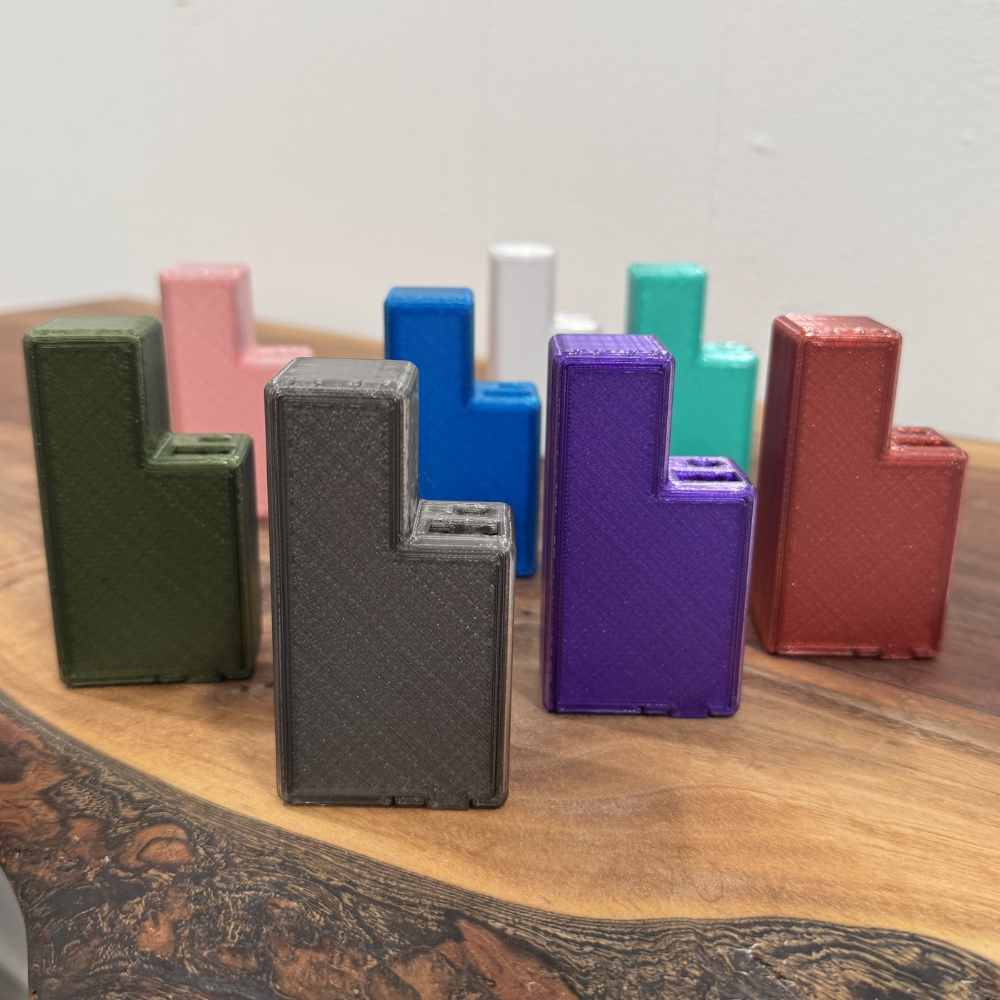

# People's Mesh Kit

**Build cheap, encrypted, off-grid text-messaging radios with your neighbors.** This repo packages Black Flag Civilian's two open designs into one guide that you can repeat, print, and use offline:

- **People's Companion** (about $25–31): the pocket radio. It pairs with your phone over Bluetooth and runs about 2 weeks on a swappable 18650. [Video](https://youtu.be/RTBM0CscnLI)
- **People's Repeater** (about $36–41): a solar node built from a $10 Lowe's garden light and a 3D-printed hub. Mount it high and it relays everyone's messages. [Video](https://youtu.be/yAmINEghCOc)

Both use **the same radio** (Seeed XIAO nRF52840 + Wio-SX1262) running **MeshCore** firmware. The *role* differs (Companion vs Repeater), and so do the housing and power wiring. See [GUIDE Part 0](GUIDE.md#part-0-same-radio-different-firmware).



## What's in here

| Path | What |
|---|---|
| [`GUIDE.md`](GUIDE.md) | **The build guide.** Print → prep → companion → repeater → flash → test, with video timestamps |
| [`BOM.md`](BOM.md) · [`bom/bom.csv`](bom/bom.csv) | Exact parts, links, prices (checked 2026-11-14) |
| `scripts/bom_calc.py` | Batch shopping list rounded to real pack sizes: `python3 scripts/bom_calc.py -c 6 -r 4` |
| `stl/` | The 4 printable files (CC0) + checksums |
| `firmware/` | **Latest stable MeshCore (v1.18.0)** for 9 boards (nRF52840 + ESP32-S3), nRF erase tools, OTAFIX bootloaders, source (MIT) |
| [`offline-flasher/`](offline-flasher/README.md) | **Run the flasher and repeater setup tool with no internet**: `python3 offline-flasher/serve.py` |
| [`docs/meshcore-links.md`](docs/meshcore-links.md) | Every MeshCore link: flasher, config, apps, docs, releases, map |
| [`docs/hardware-options.md`](docs/hardware-options.md) | Other radio boards: XIAO ESP32S3 kit, LilyGo T3S3/Heltec, other nRF boards, DIY, Raspberry Pi + HAT |
| [`docs/printing.md`](docs/printing.md) | Slicer settings (designer + Bambu P1S 0.6 mm) |
| [`docs/workshop.md`](docs/workshop.md) | How to run a weekend "build your own" session |
| `handouts/` | One-page build cards + a card for gift recipients |
| `print/` | **PDFs**: full illustrated guide, **plain black-and-white instructions** (URLs printed out), handouts |
| `sources/` | Everything the videos point to: video descriptions, Printables listing text, BFC store pages |
| [`maps/san-diego-tijuana/`](maps/san-diego-tijuana/README.md) | Printable San Diego–Tijuana topographic maps |

## Quick start

1. Agree on your area's preset (MeshCore USA 910.525 MHz, or 927.875 MHz in Southern California). See [GUIDE F-0](GUIDE.md#part-f-flash--configure-meshcore).
2. Order parts: `make bom C=6 R=4`. Order the Seeed kits first, since they ship from overseas.
3. Print: companion in PETG, repeater hub + mount in ASA. Test-fit one set first.
4. Build with the guide (or a build card) next to you, and the video open at the listed timestamp.

## Offline maps

The [San Diego–Tijuana map set](maps/san-diego-tijuana/README.md) has 26 printable topographic sheets at 1:25,000. Download both PDFs before heading offline. Print on US Letter at **Actual Size (100%)**.

## Make targets

```sh
make bom C=10 R=5   # shopping list
make pdf            # rebuild print/*.pdf (needs python3 + Chrome)
make zip            # dist/peoples-mesh-kit-<commit>.zip of the committed repo
make checksums      # verify STL and firmware files
make offline        # run the offline flasher (http://localhost:8080)
make refresh        # online: update flasher mirror, firmware, docs, apps
```

## Credits & licenses

- **Designs, STLs and photos:** [Black Flag Civilian](https://www.subscribestar.com/blackflagcivilian), released **CC0 / public domain** on Printables ([companion](https://www.printables.com/model/1832924), [repeater](https://www.printables.com/model/1768397)). Printed parts and kits are sold at <https://blackflagcivilian.bigcartel.com>. Buying there supports the designer.
- **Firmware:** [MeshCore](https://github.com/meshcore-dev/MeshCore), MIT license.
- **This guide, the BOM and the scripts:** CC BY 4.0 ([LICENSE](LICENSE)). Share and remix freely, with credit.

This is a community DIY project, not a certified product. The companion is **not waterproof**, and the repeater is weather-*resistant*. Handle lithium cells with care.
